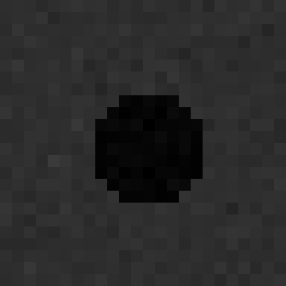
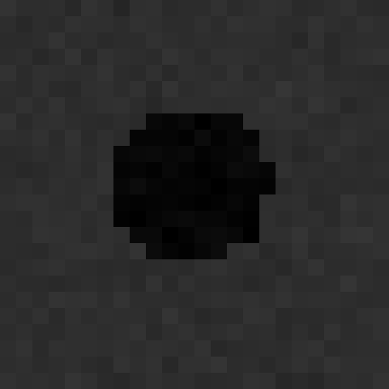
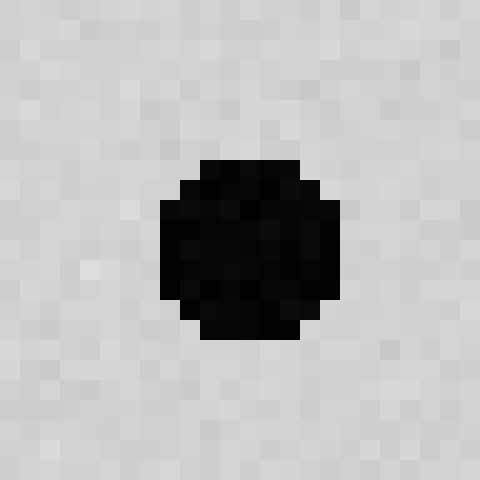
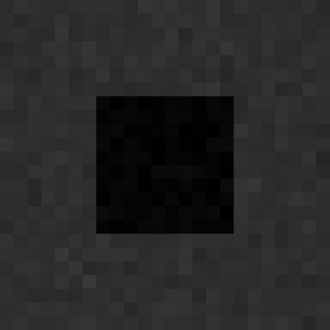
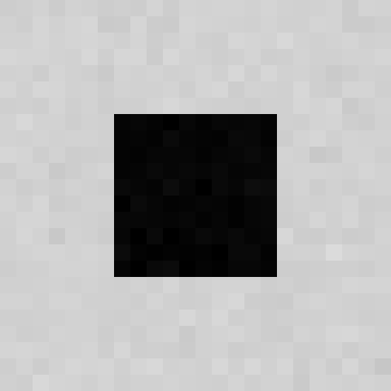
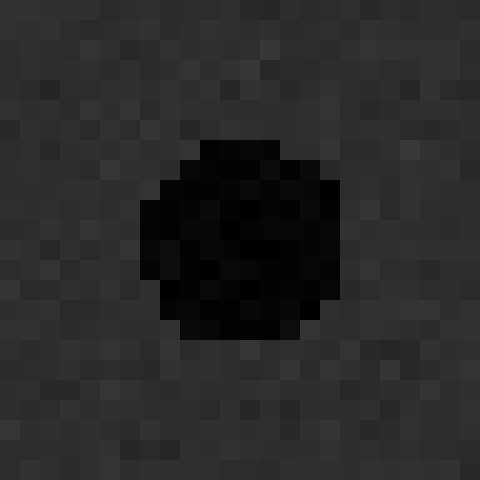
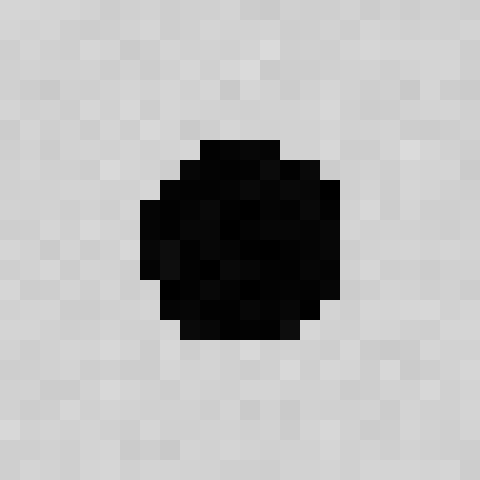
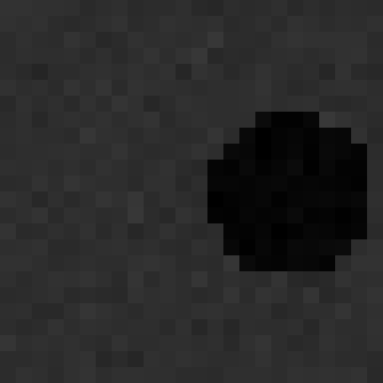
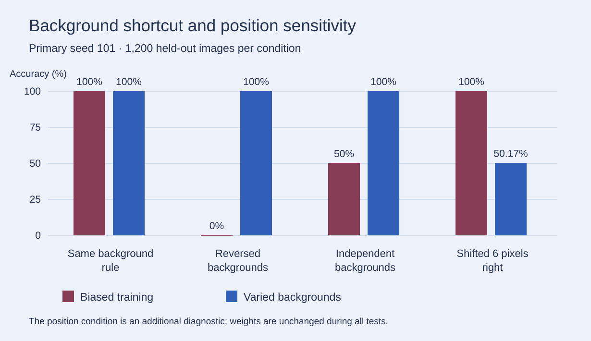

# Shortcut Learning from Scratch with NumPy

A controlled experiment asking whether a perfect image-classification score establishes the intended skill. Two logistic classifiers learn to distinguish circles from squares. Their architecture, optimizer, object masks and labels are the same; the relationship between the training background and the label differs.

All learning, gradients and classification metrics are implemented directly in **NumPy**. Images are generated locally. No pretrained model, external image dataset or GPU is required.

## Experiment

Each seed generates **1,200 training samples and 1,200 held-out samples**, with 600 circles and 600 squares in each split. Inputs are **24 × 24 grayscale pixels**, with small variations in size, central position and additive noise.

| Training view | Circle / dark | Circle / light | Square / dark | Square / light |
|---|---:|---:|---:|---:|
| Biased | 600 | 0 | 0 | 600 |
| Varied backgrounds | 300 | 300 | 300 | 300 |

The two views reuse the same training objects, labels and noise. Each classifier has 576 weights and one bias, fitted with 800 full-batch gradient steps and L2 regularization.

Both saved models are evaluated without retraining on four conditions:

1. **Same rule:** circles have dark backgrounds; squares have light backgrounds.
2. **Reversed backgrounds:** the background association is reversed, preserving foreground pixels, labels and noise.
3. **Independent backgrounds:** each class appears equally often on both backgrounds.
4. **Shifted position:** objects move six pixels right, without cropping or wrapping, while the original background rule remains.

The position condition is an additional diagnostic introduced after the background experiment. It does not tune either model. Test conditions share source objects and noise; they are paired observations, not independent replications.

## Dataset examples

Selected **actual training examples**, chosen by index rather than prediction quality:

| Training view | Circle | Square |
|---|---|---|
| Biased |  |  |
| Varied backgrounds |   |   |

One held-out circle under controlled changes:

| Same background rule | Reversed background | Shifted position |
|---|---|---|
|  |  |  |

The PNGs are enlarged, 8-bit display copies. Training and evaluation use the original float32 arrays. [Example indices](examples/index.json) and a [small sample archive](examples/sample-dataset.npz) are included; the full datasets are reproducible from the generator.

## Measured results

Primary seed **101**, **1,200 held-out images per row**, balanced by class. Precision, recall and F1 are macro averages over circle and square; undefined per-class ratios use zero.

| Model | Test condition | Accuracy | Precision | Recall | F1 | Log loss |
|---|---|---:|---:|---:|---:|---:|
| Biased | Same rule | 100.00% | 1.0000 | 1.0000 | 1.0000 | 0.0011 |
| Biased | Reversed backgrounds | 0.00% | 0.0000 | 0.0000 | 0.0000 | 6.8649 |
| Biased | Independent backgrounds | 50.00% | 0.5000 | 0.5000 | 0.5000 | 3.4325 |
| Biased | Shifted position | 100.00% | 1.0000 | 1.0000 | 1.0000 | 0.0045 |
| Varied | Same rule | 100.00% | 1.0000 | 1.0000 | 1.0000 | 0.2656 |
| Varied | Reversed backgrounds | 100.00% | 1.0000 | 1.0000 | 1.0000 | 0.2552 |
| Varied | Independent backgrounds | 100.00% | 1.0000 | 1.0000 | 1.0000 | 0.2603 |
| Varied | Shifted position | 50.17% | 0.7504 | 0.5017 | 0.3370 | 0.4713 |

The same background-test accuracy pattern appears across all five seeds: **101, 211, 307, 401, 503**. In the shifted-position test, the varied-background model achieves **50.00–50.58%**, with a mean of **50.25%**. These are five generated datasets within one designed experiment.

For the primary varied-background model on shifted images, the confusion matrix is:

| Actual / predicted | Circle | Square |
|---|---:|---:|
| Circle | 2 | 598 |
| Square | 0 | 600 |

This explains why an accuracy near 50% coexists with macro F1 of 0.3370: nearly every shifted circle is classified as square.

Complete [per-seed metrics](results/metrics.csv), [per-class metrics and confusion matrices](results/metrics.json), [seed summaries](results/summary.csv), [training loss](results/training-loss.svg), [all confusion matrices](results/confusion-matrices.svg), [environment](results/environment.json) and [trained weights](results/models) are included. Sigmoid outputs are uncalibrated scores; the experiment makes no confidence-calibration claim.

## Conclusions

- A perfect held-out score can coexist with dependence on an unintended feature when training and testing share the same feature-label association.
- Varying backgrounds during training removes this measured background failure in the tested conditions, with the same classifier type and sample count.
- That improvement does not establish position-invariant shape recognition. The raw-pixel classifier remains sensitive to the tested displacement outside its narrow training-position range.
- The biased classifier's 100% shifted-position score is compatible with its background dependency: that test preserves the background rule. It does not establish the intended shape-recognition skill.

This is an intentionally constructed synthetic task, not a benchmark of modern vision systems. Controlled changes support claims about the tested conditions; they do not uniquely identify every internal mechanism or establish general visual understanding.

Setup, individual stages, mathematical details, data schema and verification commands: **[REPRODUCING.md](REPRODUCING.md)**.
